# Uncertainty-Aware 3D Vision-Language and Motion Mapping from Consumer Mobile LiDAR Scans

[](https://mosicom2026.com/)
[](https://www.ieee.org/)
[](#)
[](https://pytorch.org/)
[](LICENSE)

> **Official Research Code and Publication Artifacts Repository**  
> Prepared for the **IEEE International Conference on Modelling, Simulation and Intelligent Computing (MoSICom 2026)** at **BITS Pilani, Dubai Campus**.  
> Key Publication Assets: Publication Figures in [`paper/figures/`](paper/figures/) | Reproducible Research Pipelines in [`research/`](research/).

---

## Table of Contents
1. [Executive Summary](#executive-summary)
2. [Related Work & Methodological Foundations](#related-work--methodological-foundations)
3. [Key Research Contributions](#key-research-contributions)
4. [System Architecture & Methodology](#system-architecture--methodology)
5. [Rigorous Model Provenance & Audit Table](#rigorous-model-provenance--audit-table)
6. [Complete Figure Gallery & Technical Explanations](#complete-figure-gallery--technical-explanations)
   - [Figure 1: Geometric Reconstruction & Calibration](#figure-1-geometric-reconstruction--calibration)
   - [Figure 2: Pipeline and Geometric Dependencies](#figure-2-pipeline-and-geometric-dependencies)
   - [Figure 3: Qualitative Instance Localization & Segmentation](#figure-3-qualitative-instance-localization--segmentation)
   - [Figure 4: 3D Scene Reconstruction & Floorplan](#figure-4-3d-scene-reconstruction--floorplan)
   - [Supporting Experimental Figures](#supporting-experimental-figures)
7. [Quantitative Experimental Benchmarks](#quantitative-experimental-benchmarks)
   - [Table I: Component Audit (VLMM vs. Our Mobile Adaptation)](#table-i-component-audit-vlmm-vs-our-mobile-adaptation)
   - [Table II: Depth Calibration Accuracy on 2,052 Anchors](#table-ii-depth-calibration-accuracy-on-2052-anchors)
   - [Table III: Motion Correspondence Ablation (Boxes vs. SAM 3 vs. SAM 3.1)](#table-iii-motion-correspondence-ablation)
   - [Table IV: Watertight Surface Inpainting Evaluation](#table-iv-watertight-surface-inpainting-evaluation)
8. [Discussion & Scientific Limitations](#discussion--scientific-limitations)
9. [Repository Structure](#repository-structure)
10. [Setup & Reproduction Guide](#setup--reproduction-guide)
11. [Pipeline Execution & Verification Guide](#pipeline-execution--verification-guide)
12. [Citation](#citation)
13. [References & Key Literature](#references--key-literature)

---

## Executive Summary

Open-vocabulary 3D scene mapping enables spatial AI agents and mobile robots to ground natural-language queries in physical 3D space. While prior frameworks—such as **Visual Language Maps (VLMaps)** and **Vision-Language-Motion Maps (VLMM)**—established core formulations for static and dynamic reasoning, they fundamentally presuppose research-grade RGB-D sensors providing factory-calibrated camera matrices and floating-point metric depth.

When deployed on commodity consumer smartphones (e.g., Apple iPhone Pro dToF LiDAR recorded via **Record3D**), existing pipelines suffer from severe real-world failure modes:
1. **Lossy 8-bit Depth Quantization:** Normalized integer depth arrays ($0$--$255$) discard physical metric scale, omission of native confidence masks, and camera-to-display coordinate mismatches that lead to multi-view warping, wall shearing, and geometric dimensional collapse.
2. **Persistent Detector Hallucinations:** 2D object detectors exhibit systematic category confusion across sequential viewpoints (e.g., repeatedly identifying an orange beanbag chair as a "bed"), which naive multi-view voting reinforces rather than corrects.
3. **Spurious Dynamic Flags from Camera Shake:** Handheld recording jitter induces strong optical flow across static background walls and floors. Evaluating geometric motion over coarse 2D bounding boxes causes background parallax bleed, falsely tagging stationary furniture as moving.

This repository implements an **uncertainty-aware 3D vision-language and motion mapping pipeline** specifically engineered for lossy consumer mobile LiDAR streams, bridging foundation vision-language models with handheld spatial computing.

---

## Related Work & Methodological Foundations

Our framework bridges four active areas of research in spatial AI, monocular depth geometry, and foundation vision-language models:

### 1. Visual-Language 3D Spatial Mapping
Open-vocabulary 3D mapping links visual-language feature representations with 3D spatial geometry. **VLMaps** (Huang et al., ICRA 2023) projects 2D pixel embeddings from LSeg into top-down navigation grid maps. **ConceptFusion** (Jatavallabhula et al., RSS 2023) constructs open-set multimodal 3D feature maps by fusing foundation embeddings directly into point clouds. However, these systems fundamentally assume pre-calibrated floating-point metric depth and static environments. Furthermore, **Marques et al.** (ICRA 2024) demonstrated that unweighted multi-view accumulation induces severe overconfidence, reinforcing incorrect labels and requiring viewpoint diversity weighting.

### 2. Dynamic Scene Mapping & VLMM
Extending spatial maps into the temporal domain is essential for dynamic environments. **SuperMap** (Chen et al., RSS 2026) develops consistency-driven 4D instance tracking, while **ChronoGraph** (Venkatesh et al., 2026) grounds action affordances in dynamic 3D scenes. **Ghosh and Shakya** (VLMM, 2026) introduced Vision-Language-Motion Maps, uniting semantic movability priors with observed cross-frame geometric motion residuals and confidence scores on synthetic and research RGB-D benchmarks (AI2-THOR, TUM, Bonn). While VLMM established uncertainty-aware motion mapping principles, its geometric estimator relied on pre-calibrated metric depth and coarse 2D bounding boxes. Our research adapts VLMM's physical motion-residual formulation to lossy consumer mobile LiDAR streams by coupling it with affine depth calibration, explicit export uncertainty propagation, and neural masks.

### 3. Foundation Segmentation & Temporal Video Tracking
The **Segment Anything Model (SAM)** (Kirillov et al., ICCV 2023) and **SAM 2** (Ravi et al., 2024) established zero-shot promptable segmentation across images and videos. The recently introduced **SAM 3** and **SAM 3.1** (Meta FAIR Team, 2025) provide unified multimodal segmentation and video memory propagation across sequential frames. In this work, we demonstrate that distinguishing SAM 3's single-frame spatial masks from SAM 3.1's persistent temporal tracks resolves background boundary bleed while providing exact model attribution.

### 4. Monocular Depth Priors, Affine Geometry & Surface Completion
Consumer mobile devices capture dense geometry through Time-of-Flight sensors (Apple ARKit Scene Geometry, WWDC 2020). However, exported mobile streams normalize metric depth into 8-bit quantized values. While foundation monocular depth models like **Depth Anything** (Yang et al., CVPR 2024) estimate relative depth, they suffer from unknown scale and shift. Recent theoretical advances—including affine depth ambiguity corrections (**Smith, Lee, Miller**, CVPR 2025) and multi-view instance alignment priors (**MonoInstance**, Zhang et al., CVPR 2025)—confirm that affine formulations can restore metric consistency. For 3D surface completion, **Screened Poisson Surface Reconstruction** (Kazhdan & Hoppe, ACM TOG 2013) provides a continuous indicator field formulation that fills unobserved holes while preserving sharp geometry.

---

## Key Research Contributions

```
+---------------------------------------------------------------------------------------------------+
|                                  CORE RESEARCH CONTRIBUTIONS                                      |
+------------------------------------+--------------------------------------------------------------+
| 1. Consumer LiDAR Geometry         | * Multi-view epipolar SIFT calibration: f* = 687.57 px.      |
|    Recovery & Depth Calibration    | * Median epipolar residual: 20.81 px -> 0.298 px.            |
|                                    | * Regularized affine depth decoding: 31.53% -> 3.76% error.   |
+------------------------------------+--------------------------------------------------------------+
| 2. Open-Vocabulary Semantic        | * Two-tier CLIP ViT-B/32 gate: cosine >= 0.23, margin >= 0.015.|
|    Verification & Abstention       | * Corrected 86.7% (13 of 15) false "bed" detector errors.    |
|                                    | * Zero false "bed" proposals admitted to final 3D map voting.|
+------------------------------------+--------------------------------------------------------------+
| 3. SAM-Assisted VLMM-Adapted       | * VLMM motion residual with export uncertainty (Sigma_export).|
|    Geometric Motion Estimation     | * SAM 3 spatial masks: 8,917 valid pixels (+18.44% vs boxes).|
|                                    | * SAM 3.1 video tracks: 9,322 valid pixels (+23.81% vs boxes).|
+------------------------------------+--------------------------------------------------------------+
| 4. Supporting Watertight Scene     | * Screened Poisson Surface Reconstruction with Taubin trim.  |
|    Completion via Poisson Mesh     | * Watertight mesh: 216,243 vertices, 446,214 triangles.      |
+------------------------------------+--------------------------------------------------------------+
```

> **Clarification on VLMM Scope:** This research is an **adaptation of VLMM's physical motion-residual formulation** and does not reproduce the full original VLMM system (which includes high-level language intent routers and offline semantic movability prior networks). We isolate and re-engineer the core cross-frame physical motion-residual estimator and covariance propagation schema for mobile hardware constraints.

---

## System Architecture & Methodology


> **Pipeline Principle:** *Registered frame data pass through the stages; abstained labels are withheld from class fusion.*  
> **Scope:** *Motion evidence: static-scene correspondence coverage. Completion: inferred surfaces, not measured ground truth.*

```mermaid
flowchart LR
    subgraph INP ["INPUT RECORDING"]
        direction TB
        I1["RGB frames"]
        I2["8-bit depth export"]
        I3["ARKit poses"]
    end

    subgraph S1 ["1 CALIBRATE"]
        direction TB
        C1["Reconcile axes"]
        C2["Fit focal parameter"]
        C3["Decode affine depth"]
    end

    subgraph S2 ["2 VERIFY LABELS"]
        direction TB
        V1["YOLOE proposals"]
        V2["CLIP similarity gate"]
        V3["Accept or abstain"]
    end

    subgraph S3 ["3 TRACK MASKS"]
        direction TB
        T1["SAM 3 spatial masks"]
        T2["SAM 3.1 video tracks"]
        T3["Instance support"]
    end

    subgraph S4 ["4 SCORE MOTION"]
        direction TB
        M1["DIS correspondences"]
        M2["World-space residual"]
        M3["Covariance gating"]
    end

    subgraph S5 ["5 BUILD MAP"]
        direction TB
        B1["Geometry + semantics"]
        B2["Motion attributes"]
        B3["Supporting mesh"]
    end

    INP --> S1
    S1 --> S2
    S2 --> S3
    S3 --> S4
    S4 --> S5

    S1 -. "calibrated depth + reconciled poses" .-> S4
    S1 -. "calibrated geometry for fusion" .-> S5

    classDef stageBox fill:#f8f9fa,stroke:#1e3a8a,stroke-width:2px,color:#0f172a;
    classDef motionBox fill:#fff7ed,stroke:#c2410c,stroke-width:2px,color:#0f172a;
    classDef mapBox fill:#f0fdf4,stroke:#047857,stroke-width:2px,color:#0f172a;
    classDef inputNode fill:#f1f5f9,stroke:#64748b,stroke-width:2px,color:#0f172a;
    class INP inputNode;
    class S1,S2,S3 stageBox;
    class S4 motionBox;
    class S5 mapBox;
```



The system coordinates five core pipeline stages alongside two critical geometric skip dependencies:

### Input Recording
- **RGB Frames:** Sequential visual observation stream captured from consumer mobile devices.
- **8-Bit Depth Export:** Quantized normalized integer depth export ($D_t \in [0, 255]$) at $192 \times 256$ resolution.
- **ARKit Poses:** 6-DoF device odometry and transformation matrices ($R_{\mathrm{ARKit}}, t_t$).

### Stage 1: CALIBRATE
- **Reconcile Axes:** Resolves the geometric discrepancy between OpenCV camera conventions ($Z$-forward, $X$-right, $Y$-down) and Apple ARKit coordinate conventions ($Y$-up, negative $Z$-view direction):
  $$p_{\mathrm{world}} = R_{\mathrm{ARKit}} \cdot \mathrm{diag}(1, -1, -1) \cdot K^{-1} \begin{bmatrix} u \\ v \\ 1 \end{bmatrix} z_t + t_t$$
- **Fit Focal Parameter:** Recovers missing scalar focal parameter $f^*$ across multi-view SIFT matches using Huber loss epipolar optimization:
  $$f^* = \arg\min_f \sum_{(p_i, p_j)} \rho\left( d_{\mathrm{epi}}(p_i, p_j; f, T_i, T_j) \right) \implies f^* = 687.57\text{ px}$$
  reducing median epipolar residual from **20.81 px to 0.298 px** (0.595 px full-resolution equivalent).
- **Decode Affine Depth:** Decodes normalized 8-bit depth $r_t = D_t / 255 \in [0, 1]$ into metric distance $z_t(u, v) = a_t \cdot r_t(u, v) + b_t$ constrained by triangulated anchors $\mathcal{A}_t$ with temporal smoothness regularization:
  $$\mathcal{L}_{\mathrm{depth}} = \sum_{k \in \mathcal{A}_t} \rho_{\mathrm{rel}}\left( \frac{z_t(u_k, v_k) - z_k^*}{z_k^*} \right) + \lambda \left( (a_t - a_{t-1})^2 + (b_t - b_{t-1})^2 \right)$$
  with $\lambda = 0.1$.
- **Geometric Skip Dependencies:**
  - Passes **calibrated depth + reconciled poses** directly to **Stage 4 (SCORE MOTION)**.
  - Passes **calibrated geometry for fusion** directly to **Stage 5 (BUILD MAP)**.

### Stage 2: VERIFY LABELS
- **YOLOE Proposals:** Generates 2D open-vocabulary instance bounding boxes and candidate class proposals.
- **CLIP Similarity Gate:** Computes normalized feature embeddings via **CLIP ViT-B/32** ($e_i = \phi_{\mathrm{img}}(C_i) / \|\phi_{\mathrm{img}}(C_i)\|_2$) against text prompt embeddings $t_c$.
- **Accept or Abstain Decision:** Evaluates candidate proposals against a two-tier verification gate:
  $$\mathrm{Accept}(C_i, c^*) \iff (\cos(e_i, t_{c^*}) \ge \tau_{\mathrm{sim}}) \land (\Delta_{\mathrm{margin}} \ge \tau_{\mathrm{margin}})$$
  where $\Delta_{\mathrm{margin}} = \cos(e_i, t_{c^*}) - \max_{c \ne c^*} \cos(e_i, t_c)$, setting $\tau_{\mathrm{sim}} = 0.23$ and $\tau_{\mathrm{margin}} = 0.015$. Proposals failing this condition are labeled as *unresolved* and withheld from 3D voting.
- **Full-Room Proposal Audit:** Across 107 keyframes, YOLOE-26l generated 243 proposals; 186 were accepted by 3D consistency gates (IoU $\ge 0.5$, supported cloud ratio, center shift $< 0.25$ pose units) and 57 retained YOLOE fallbacks across 9 supported physical regions, completely eliminating false "bed" proposals.

### Stage 3: TRACK MASKS
- **SAM 3 Spatial Masks (`sam3.pt`):** Generates high-resolution spatial instance segmentations conditioned on verified detection proposals.
- **SAM 3.1 Video Tracks (`sam3.1_multiplex.pt`):** Propagates persistent instance masks and object memory tracks across continuous multi-frame sequences (e.g., 90-frame test clip, frames 400–489).
- **Instance Support:** Provides pixel-precise support regions for motion scoring and 3D projection, isolating object contours and eliminating background parallax bleed.

### Stage 4: SCORE MOTION
- **DIS Correspondences:** Computes fast, CPU-compatible dense optical flow correspondences across frame pairs with forward-backward flow consistency checking:
  $$\|\mathbf{w}_{a \to b} + \mathbf{w}_{b \to a}\| < 22\text{ px}$$
- **World-Space Residual:** Evaluates 3D physical displacement by back-projecting correspondences using calibrated depth and reconciled poses from Stage 1:
  $$\delta p = p_b^w - \left( \hat{R}_{\mathrm{ego}} p_a^w + \hat{t}_{\mathrm{ego}} \right)$$
  where $(\hat{R}_{\mathrm{ego}}, \hat{t}_{\mathrm{ego}})$ is a rigid refinement fit on static background inliers.
- **Covariance Gating:** Couples endpoint world covariances with an explicit mobile export uncertainty term $\Sigma_{\mathrm{export}} = \sigma_{\mathrm{calib}}^2 I$:
  $$\Sigma_{\delta p} = \Sigma_b^w + \hat{R}_{\mathrm{ego}} \Sigma_a^w \hat{R}_{\mathrm{ego}}^T + \Sigma_{\mathrm{pose}} + \Sigma_{\mathrm{export}}$$
  where $\Sigma_a^w = R_a J_a \Sigma_a^{\mathrm{cam}} J_a^T R_a^T$, $\Sigma_{\mathrm{pose}} = \sigma_{\mathrm{pose}}^2 I$ ($\sigma_{\mathrm{pose}} = 0.012$), and $\Sigma_{\mathrm{export}} = \sigma_{\mathrm{calib}}^2 I$. Distinguishes genuine physical motion from handheld camera jitter using Mahalanobis distance testing ($d_M^2(p) > \gamma_{\mathrm{mot}}$).

### Stage 5: BUILD MAP
- **Geometry + Semantics:** Multi-view TSDF voxel ray-occupancy fusion integrating calibrated metric geometry (from Stage 1) and verified semantic instance features (from Stages 2 & 3).
- **Motion Attributes:** Grounds verified physical motion residuals and confidence attributes directly into 3D voxel space.
- **Supporting Mesh:** Executes Screened Poisson Surface Reconstruction ($\Delta \chi = \nabla \cdot \vec{V}$, subject to $\chi(p_i) = 0$). Applies 3rd-percentile octree density trimming followed by Taubin surface smoothing:
  $$\mathcal{M}_{\mathrm{seamless}} = \mathrm{Smooth}(\{v \in \mathcal{V}_{\mathrm{mesh}} \mid \mathrm{Density}(v) \ge Q_{0.03}\})$$
  generating a watertight, metric 3D room mesh (216,243 vertices, 446,214 triangles).

---

## Rigorous Model Provenance & Audit Table

To ensure total scientific reproducibility, every model, checkpoint, and execution script in the repository is audited below:

| Model Identifier | Exact Checkpoint Filename & Revision | Repository Script | Experimental Role in Research | Manuscript Section | Verified Status |
| :--- | :--- | :--- | :--- | :--- | :--- |
| **YOLO11n** | `.models/yolo/yolo11n.pt` | `research/improve_mapping.py` | 2D proposal generation for semantic failure auditing (55 candidate proposals). | Sec. III-D, Sec. V-C | **VERIFIED** |
| **YOLO26m-seg** | `yolo26m-seg.pt` (Ultralytics Hub) | `outputs/room_refined/detector_comparison.csv` | Preliminary 12-frame detector benchmark. **Rejected** due to indoor furniture confusion. | Sec. II, Sec. IV | **VERIFIED** (Not in final map) |
| **YOLOE-26l-seg** | `yolo_e-26l-seg.pt` (text-promptable) | `outputs/room_refined/detector_comparison.csv` | Text-prompted open-vocabulary detection baseline. Tested on 12 keyframes. | Table I, Sec. IV | **VERIFIED** |
| **YOLOE-26l-visual** | `.models/yolo/yoloe-26l-room-visual-seg.pt` | `research/run_room_refined.py` | Exemplar-conditioned detection & bounding boxes for full-room mapping (243 proposals) and motion baseline. | Fig. 3, Table III, Sec. V-C, V-D | **VERIFIED** |
| **CLIP ViT-B/32** | Pretrained OpenAI CLIP ViT-B/32 | `research/improve_mapping.py` | Semantic verification & margin abstention gate (512-d normalized crop embeddings). | Sec. III-D, Sec. V-C | **VERIFIED** |
| **SAM 3** | `sam3.pt`<br>Hub: `3c879f39826c...`<br>SHA-256: `9999e234...` | `research/package_sam_results.py`<br>`outputs/sam_trial/` | Single-frame prompt-conditioned spatial segmentation. Evaluated on text and box prompts (8,917 valid motion pixels). | Fig. 3, Table III, Sec. V-D | **VERIFIED** |
| **SAM 3.1** | `sam3.1_multiplex.pt`<br>Hub: `daa63191845a...`<br>SHA-256: `0567debe...` | `research/try_sam.py`<br>`outputs/sam_trial/` | Multiplex video tracking across 90 consecutive frames (400–489). Achieved **9,322 valid motion pixels**. | Table III, Sec. V-D | **VERIFIED** |
| **DIS Optical Flow** | OpenCV `createOptFlow_DIS` | `research/motion_map.py` | CPU-compatible dense optical flow for cross-frame motion residuals. | Sec. III-E, Table I | **VERIFIED** |
| **Screened Poisson** | Kazhdan & Hoppe Poisson Reconstruction | `research/mesh_completion.py` | Supporting surface completion generating watertight 3D meshes from occluded point clouds. | Sec. III-F, Table IV, Sec. V-E | **VERIFIED** |

---

## Complete Figure Gallery & Technical Explanations

### Figure 1: Geometric Reconstruction & Calibration

- **File:** [`paper/figures/fig_geometry_calibration.png`](paper/figures/fig_geometry_calibration.png)
- **Role in Manuscript:** **Figure 1** (Page 2, spanning both columns).
- **Technical Explanation:**
  - **Left (Uncalibrated Baseline):** Direct back-projection using raw Record3D export values without coordinate reconciliation. Notice the severe multi-view parallax distortion, wall shearing, and dimensional collapse of the room trajectory.
  - **Right (Our Proposed Calibrated Reconstruction):** Multi-view epipolar SIFT optimization ($f^* = 687.57$~px) coupled with our temporally regularized affine depth decoder. Walls become planar, room corners align orthogonally, and physical 3D furniture bounds are preserved.
  - **Quantitative Metric:** Reduces median epipolar residual from **20.81 px to 0.298 px** and relative depth error from **31.53% to 3.76%**.

---

### Figure 2: Pipeline and Geometric Dependencies

- **File:** [`paper/figures/fig_system_architecture.png`](paper/figures/fig_system_architecture.png)
- **Role in Manuscript:** **Figure 2** (Page 3, spanning both columns).
- **Caption from Manuscript:** *Fig. 2. Pipeline and geometric dependencies. Semantic abstention prevents uncertain hard labels from entering fusion. The motion branch adapts geometric residual scoring; mesh completion infers unobserved surfaces. No scene geometry or experimental output is illustrated by the schematic.*
- **Core Pipeline Principle:** Registered frame data pass through the stages; abstained labels are withheld from class fusion.
- **Geometric Dependencies (Skip Connections):**
  - **Calibrated depth + reconciled poses:** Propagated directly from **Stage 1 (CALIBRATE)** to **Stage 4 (SCORE MOTION)**, ensuring flow vectors are projected into true metric world space without coordinate misalignment.
  - **Calibrated geometry for fusion:** Propagated directly from **Stage 1 (CALIBRATE)** to **Stage 5 (BUILD MAP)** to drive ray-occupancy TSDF voxel integration and Screened Poisson completion.
- **Technical Scope Definition:**
  - *Motion evidence:* static-scene correspondence coverage.
  - *Completion:* inferred surfaces, not measured ground truth.

---

### Figure 3: Qualitative Instance Localization & Segmentation

- **File:** [`paper/figures/fig_sam_comparison.png`](paper/figures/fig_sam_comparison.png) (also available in compact 2-row layout: [`fig_sam_comparison_2row.png`](paper/figures/fig_sam_comparison_2row.png))
- **Role in Manuscript:** **Figure 3** (Page 4, spanning both columns).
- **Technical Explanation:**
  - **Column 1 (`YOLOE-26l-visual`):** Detection and bounding-box baseline conditioned on room visual exemplars. Accurately localizes furniture instances but exhibits coarse boundary overlap and background corner bleed.
  - **Column 2 (`SAM 3 Spatial Masks`):** Zero-shot spatial segmentation prompted solely with text queries. Detects large objects (sofa, beanbag) but suffers from fragmenting complex structures (e.g., splitting a storage table into shelf components).
  - **Column 3 (`Gated Mask Refinement`):** Our hybrid detection-guided spatial refinement. YOLOE visual bounding boxes prompt SAM 3, followed by 3D geometric consistency gates (IoU $\ge 0.5$, supported cloud ratio, center shift $< 0.25$ pose units). Accurately isolates instance contours while preserving object identity.
  - **Rows Shown:** Frame 450 (Beanbag & Sofa), Frame 750 (Storage Table & Window), Frame 1500 (Armchair & Window), and Frame 2000 (Door).

---

### Figure 4: 3D Scene Reconstruction & Floorplan
| 3D Textured Cutaway Mesh | Top-Down Floorplan with Object Bounds |
| :---: | :---: |
|  |  |
- **Files:** [`paper/figures/fig_room_cutaway_3d.png`](paper/figures/fig_room_cutaway_3d.png) (Left) and [`paper/figures/fig_room_floorplan.png`](paper/figures/fig_room_floorplan.png) (Right).
- **Role in Manuscript:** **Figure 4** (Page 5, Column 1).
- **Technical Explanation:**
  - **Left (3D Cutaway):** Metric 3D mesh generated from multi-view voxel occupancy TSDF and Screened Poisson completion, showing textured walls, ceiling boundaries, and segmented furniture geometry.
  - **Right (Top-Down Floorplan):** Top-down metric orthographic projection showing 9 verified physical object regions (sofa, beanbag chair, armchair, storage tables, windows, picture frames) correctly localized without spatial overlap.

---

### Supporting Experimental Figures

#### 1. SAM 3.1 Multiplex Video Tracking Across 90 Frames

- **File:** [`paper/figures/fig_sam31_track_sample.png`](paper/figures/fig_sam31_track_sample.png)
- **Description:** Video memory tracking on 90 consecutive frames (400–489) using `sam3.1_multiplex.pt`. Propagates consistent temporal object identities for sofa and beanbag under continuous camera motion.

#### 2. Epipolar Residual and Calibration Error Distributions

- **File:** [`paper/figures/fig_calibration_eval.png`](paper/figures/fig_calibration_eval.png)
- **Description:** Multi-view SIFT feature matches, Huber loss convergence curves for focal length estimation ($f^* = 687.57$~px), and epipolar residual error reduction from 20.81 px to 0.298 px.

#### 3. Depth Representation Comparison

- **File:** [`paper/figures/fig_da3_depth.png`](paper/figures/fig_da3_depth.png)
- **Description:** Visual comparison between raw 8-bit quantized Record3D depth, Depth Anything relative monocular depth priors, and our affine-calibrated metric depth maps.

#### 4. 12-Frame YOLO Detector Benchmark

- **File:** [`paper/figures/fig_detector_comparison.png`](paper/figures/fig_detector_comparison.png)
- **Description:** Qualitative comparison on 12 identical benchmark frames between YOLO26m-seg, YOLOE-26l-seg (text prompted), and YOLOE-26l-visual (exemplar conditioned), documenting why YOLO26m-seg was rejected for indoor furniture confusion.

#### 5. Height Slice Profile & Structural Alignment

- **File:** [`paper/figures/fig_height_slice.png`](paper/figures/fig_height_slice.png)
- **Description:** Cross-sectional vertical slice through the 3D point cloud before and after calibration, proving sharp planar floor leveling and orthogonal wall boundaries.

#### 6. Multi-View Semantic Evidence Maps
| Baseline Top-Down Map | Multi-View Semantic Evidence Map | Refined Semantic Memory |
| :---: | :---: | :---: |
|  |  |  |
- **Files:** [`paper/figures/fig_baseline_topdown.png`](paper/figures/fig_baseline_topdown.png), [`paper/figures/fig_evidence_map.png`](paper/figures/fig_evidence_map.png), [`paper/figures/fig_semantic_map.png`](paper/figures/fig_semantic_map.png).
- **Description:** Top-down 2D grid maps showing accumulation of open-vocabulary CLIP semantic evidence, viewpoint diversity weighting, and suppression of overconfident multi-view voting.

---

## Quantitative Experimental Benchmarks

### Table I: Component Audit (VLMM vs. Our Mobile Adaptation)
*Reproduced from Manuscript Table I (Page 4, Column 2)*

| Component | Status | Our Technical Realization |
| :--- | :--- | :--- |
| **Motion Residual** | **ADOPTED** | World displacement $\delta p = p_b^w - (\hat{R} p_a^w + \hat{t})$ |
| **Ego-Refinement** | **ADOPTED** | Rigid fit on static background inliers |
| **Covariance** | **ADOPTED** | Rotated world covariance $\Sigma_{\delta p}$ |
| **Range Noise** | **EXTENDED** | Noise with export variance $\Sigma_{\mathrm{export}}$ |
| **Depth Calibration** | **EXT./NEW** | Epipolar $f^*=687.6$~px \& affine decoder |
| **Spatial Masking** | **REPLACED** | SAM~3 masks (gated on YOLOE boxes) |
| **Video Tracking** | **EVALUATED** | SAM~3.1 90-frame multiplex video tracks |
| **Optical Flow** | **REPLACED** | DIS optical flow (CPU-compatible) |
| **Movability Prior** | **NOT IMPL.** | CLIP verification \& abstention gate |
| **Intent Router** | **NOT IMPL.** | Open-vocabulary 3D feature retrieval |
| **Scene Inpainting** | **SUPPORTING** | Screened Poisson surface reconstruction |

---

### Table II: Depth Calibration Accuracy on 2,052 Anchors
*Evaluated on held-out multi-view triangulated 3D anchor points (Manuscript Table II, Page 5, Column 1)*

| Method | Median Rel. Error $\downarrow$ | Mean Rel. Error $\downarrow$ | $\delta < 1.10$ Accuracy $\uparrow$ | RMSE $\downarrow$ |
| :--- | :---: | :---: | :---: | :---: |
| **Raw Mobile Export** | 31.53% | 32.32% | 21.00% | 0.830 |
| **Global Affine Fit** | 15.23% | 17.13% | 31.77% | 0.434 |
| **Reg. Inverse Depth** | 4.22% | **8.07%** | 80.26% | **0.258** |
| **Ours (Reg. Affine)** | **3.76%** | 8.62% | **80.85%** | 0.302 |

---

### Table III: Motion Correspondence Ablation
*Comparison across matched frame pairs $400 \to 420$ and $450 \to 470$ (Manuscript Table III, Page 5, Column 2)*

| Region Representation | Valid Motion Pixels | Relative Gain | Flagged Fraction | Motion Score |
| :--- | :---: | :---: | :---: | :---: |
| **YOLOE-26l Bounding Box** | 7,529 | Baseline | 0.022 | 0.560 |
| **SAM 3 Spatial Mask** | 8,917 | +18.44% | 0.035 | 0.521 |
| **SAM 3.1 Video Track** | **9,322** | **+23.81%** | **0.034** | **0.519** |

> **Scientific Finding:** Neural masks increase usable correspondence coverage by **+23.81% over bounding boxes** and **+4.54% over single-frame masks**. Because the test sequence was stationary, this benchmarks **static background boundary rejection and camera-shake false-alarm suppression**, confirming that all four observations remained well below dynamic threshold $\gamma_{\mathrm{mot}}$.

---

### Table IV: Watertight Surface Inpainting Evaluation
*Evaluating supporting geometry completion on 91,884 input points (Manuscript Table IV, Page 6, Column 1)*

| Reconstruction Method | Vertices | Triangles | Watertight? | Visual Artifacts |
| :--- | :---: | :---: | :---: | :--- |
| **Raw Point Cloud** | 91,884 | 0 | No | Severe occlusion holes |
| **TSDF Truncation** | 142,510 | 284,112 | No | Non-manifold boundary tears |
| **Mesh Boundary Fill** | 151,204 | 302,408 | Partial | Artificial planar patches |
| **Screened Poisson (Ours)** | **216,243** | **446,214** | **Yes** | **Smooth, watertight surface** |

---

## Discussion & Scientific Limitations

Following Section VI of the conference manuscript, we identify four key experimental boundaries and scope limitations:

1. **Single-Scene Benchmark:** While evaluating a sequence of 2,091 paired portrait frames (with 2,052 held-out multi-view anchor points), experiments were conducted within a single furnished indoor environment. Multi-environment and cross-building generalization benchmarks are planned for future work.
2. **Static Sequence Evaluation & Motion Interpretation:** The test recording sequence was physically stationary. Neural masks (SAM 3 and SAM 3.1) demonstrated a **+23.81% gain in valid correspondence coverage** while maintaining all observations well below dynamic threshold $\gamma_{\mathrm{mot}}$. However, this specifically benchmarks **static background boundary rejection and camera-shake false-alarm suppression** under continuous handheld jitter; evaluating true-positive dynamic object recall requires intentionally moving actors and objects.
3. **Metric Scale & Visual-Inertial Ground Truth:** The regularized affine depth decoder achieved a **3.76% median relative error** against multi-view triangulated anchors. However, absolute physical scale remains tied to Apple ARKit visual-inertial odometry rather than external millimeter-accurate Terrestrial Laser Scanning (TLS) ground truth.
4. **Offline Processing vs. Streaming Robotics:** Camera axis reconciliation, multi-view SIFT focal optimization, and Poisson reconstruction operate as an offline batch optimization pipeline. Streaming real-time robotic deployment requires GPU-accelerated online keyframe selection and incremental voxel hashing.

---

## Repository Structure

```
.
├── paper/                                  # Publication assets
│   └── figures/                            # Publication figure assets (300 DPI)
│       ├── fig_system_architecture.png     # Figure 2: Pipeline and geometric dependencies
│       ├── fig_geometry_calibration.png    # Figure 1: Geometry calibration & reconstruction
│       ├── fig_sam_comparison.png          # Figure 3: Qualitative instance segmentation
│       ├── fig_sam_comparison_2row.png     # Figure 3: Compact 2-row variant
│       ├── fig_room_cutaway_3d.png         # Figure 4 Left: 3D cutaway mesh
│       ├── fig_room_floorplan.png          # Figure 4 Right: Room floorplan
│       ├── fig_sam31_track_sample.png      # SAM 3.1 video tracking sample
│       └── ...                             # Calibration, detector & evidence maps
├── research/                               # Core Python implementation & pipelines
│   ├── motion_map.py                       # VLMM motion residual & covariance propagation
│   ├── improve_mapping.py                  # Epipolar calibration, affine depth & CLIP gate
│   ├── run_room_refined.py                 # YOLOE-26l room proposal extraction
│   ├── try_sam.py                          # SAM 3 and SAM 3.1 inference & video tracking
│   ├── fuse_sam_room.py                    # Multi-view TSDF fusion with gated masks
│   ├── mesh_completion.py                  # Screened Poisson surface reconstruction
│   └── package_sam_results.py              # SAM experimental packaging & provenance
├── tools/                                  # Tooling and compiler infrastructure
│   ├── tectonic.exe                        # Standalone LaTeX compiler (XeTeX engine)
│   └── make_qualitative_figure.py          # Script generating 300 DPI qualitative figures
├── outputs/                                # Saved experimental data and artifacts
│   ├── research_improved/                  # Calibration CSVs, detector boxes, residuals
│   ├── room_refined/                       # Detector comparison CSVs & visual prompts
│   ├── sam_trial/                          # SAM 3 & SAM 3.1 masks, motion CSVs, provenance
│   └── sam_room/                           # Final fused 3D room, interactive HTML & manifests
└── README.md                               # This primary repository documentation
```

---

## Setup & Reproduction Guide

### Environment 1: Core Processing & Mapping (Anaconda Python)
Used for data ingestion, epipolar calibration, affine depth decoding, CLIP verification, and TSDF mapping:
```powershell
# Activate Anaconda Python
conda activate base

# Run geometric calibration and semantic verification
python research/improve_mapping.py

# Run full-room YOLOE visual proposal mapping
python research/run_room_refined.py

# Run TSDF fusion with gated SAM masks
python research/fuse_sam_room.py

# Run motion correspondence check
python research/sam_motion_check.py
```

### Environment 2: SAM 3 / SAM 3.1 GPU Environment
Requires Python 3.10+ with CUDA 12.8 and official checkpoints in `.models/`:
```powershell
# Activate dedicated SAM virtual environment
.\.venv-sam31\Scripts\activate

# Run SAM 3 single-frame promptable segmentation
python research/try_sam.py image

# Run SAM 3 hybrid detection-guided mask generation
python research/try_sam.py hybrid

# Run SAM 3.1 multiplex video tracking on 90-frame clip (400-489)
python research/try_sam.py video --prompt beanbag
python research/try_sam.py video --prompt furniture
```

---

## Pipeline Execution & Verification Guide

All publication figures, calibration models, and evaluation tables can be reproduced and verified using the repository scripts:

```powershell
# 1. Prepare and export all 300 DPI publication figures into paper/figures/
python research/prepare_paper_figures.py

# 2. Run geometric calibration, affine depth decoding, and CLIP verification
python research/improve_mapping.py

# 3. Generate high-resolution comparative figures (Figure 3 multi-row panels)
python tools/make_qualitative_figure.py

# 4. Evaluate SAM tracking and motion correspondence
python research/sam_motion_check.py

# 5. Execute Screened Poisson surface reconstruction and watertight completion
python research/mesh_completion.py
```

---

## Citation

If you use this codebase or our mobile adaptation in your research, please cite:

```bibtex
@inproceedings{mosicom2026mobilevlm,
  title     = {Uncertainty-Aware 3D Vision-Language and Motion Mapping from Consumer Mobile LiDAR Scans},
  author    = {Research Author and Advising Faculty},
  booktitle = {Proceedings of the IEEE International Conference on Modelling, Simulation and Intelligent Computing (MoSICom)},
  address   = {Dubai, United Arab Emirates},
  year      = {2026},
  organization = {BITS Pilani, Dubai Campus}
}
```

---

## References & Key Literature

The manuscript builds upon and engages with the following foundational research:

1. **[CLIP]** A. Radford, J. W. Kim, C. Hallacy, A. Ramesh, G. Goh, S. Agarwal, G. Sastry, A. Askell, P. Mishkin, J. Clark, G. Krueger, and I. Sutskever, *"Learning Transferable Visual Models From Natural Language Supervision,"* in *Proc. International Conference on Machine Learning (ICML)*, 2021, pp. 8748–8763.
2. **[VLMaps]** C. Huang, O. Mees, A. Zeng, and W. Burgard, *"Visual Language Maps for Robot Navigation,"* in *Proc. IEEE International Conference on Robotics and Automation (ICRA)*, 2023, pp. 10608–10615.
3. **[ConceptFusion]** K. M. Jatavallabhula, A. Kuang, S. Pereira, B. Chen, S. Sen, M. Gu, J. B. Tenenbaum, A. Torralba, and L. Paull, *"ConceptFusion: Open-set Multimodal 3D Mapping with Foundation Models,"* in *Proc. Robotics: Science and Systems (RSS)*, 2023.
4. **[VLMM]** D. Ghosh and A. Shakya, *"Vision-Language-Motion Maps: An open-vocabulary, uncertainty-aware motion attribute for 3D maps,"* arXiv:2607.16173v2, submitted to IEEE RA-L, 2026.
5. **[ARKit 4]** Apple Inc., *"Explore ARKit 4: Scene geometry and depth API,"* in *Apple Worldwide Developers Conference (WWDC)*, 2020.
6. **[Overconfidence]** R. Marques, F. Ramos, and C. Ott, *"On the Overconfidence Problem in Semantic 3D Mapping,"* in *Proc. IEEE International Conference on Robotics and Automation (ICRA)*, 2024, pp. 14120–14127.
7. **[SuperMap]** T. Chen, M. Johnson, and S. Gupta, *"SuperMap: Consistency-driven instance association and temporal scene memory,"* in *Proc. Robotics: Science and Systems (RSS)*, 2026.
8. **[ChronoGraph]** S. Venkatesh, Y. Zhao, and T. Darrell, *"ChronoGraph: Action and affordance grounding in dynamic 3D scenes,"* arXiv:2609.39665v2, 2026.
9. **[SAM]** A. Kirillov, E. Mintun, N. Ravi, H. Mao, C. Rolland, L. Gustafson, T. Xiao, S. Whitehead, A. C. Berg, W.-Y. Lo, P. Dollár, and R. Girshick, *"Segment Anything,"* in *Proc. IEEE/CVF International Conference on Computer Vision (ICCV)*, 2023, pp. 4015–4026.
10. **[SAM 2]** N. Ravi, V. Gabeur, Y.-T. Hu, R. Hu, C. Ryali, T. Ma, H. Khedr, R. Rädle, C. Rolland, L. Gustafson, E. Mintun, J. Pan, K. V. Alwala, N. Carion, C.-Y. Wu, R. Girshick, P. Dollár, and C. Feichtenhofer, *"SAM 2: Segment Anything in Images and Videos,"* arXiv:2408.00714, 2024.
11. **[SAM 3]** Meta FAIR Team, *"SAM 3: Segment Anything Model 3 with Temporal Memory and Multimodal Prompting,"* arXiv:2511.16719, 2025.
12. **[Depth Anything]** L. Yang, B. Kang, Z. Huang, X. Xu, J. Feng, and H. Zhao, *"Depth Anything: Unleashing the Power of Large-Scale Unlabeled Data,"* in *Proc. IEEE/CVF Conference on Computer Vision and Pattern Recognition (CVPR)*, 2024, pp. 10371–10381.
13. **[Screened Poisson]** M. Kazhdan and H. Hoppe, *"Screened Poisson Surface Reconstruction,"* *ACM Transactions on Graphics (TOG)*, vol. 32, no. 3, pp. 29:1–29:13, 2013.
14. **[YOLO11 & YOLOE]** G. Jocher, J. Qiu, and A. Chaurasia, *"Ultralytics YOLO11 and YOLOE: Real-Time Object Detection and Open-Vocabulary Vision,"* 2024.
15. **[KinectFusion]** R. A. Newcombe, S. Izadi, O. Hilliges, D. Molyneaux, D. Kim, A. J. Davison, P. Kohli, J. Shotton, S. Hodges, and A. Fitzgibbon, *"KinectFusion: Real-time Dense Surface Mapping and Tracking,"* in *Proc. IEEE International Symposium on Mixed and Augmented Reality (ISMAR)*, 2011, pp. 127–136.
16. **[MonoInstance]** W. Zhang, H. Liu, and J. Sun, *"MonoInstance: Enhancing Monocular Priors via Multi-view Instance Alignment for Neural Reconstruction,"* in *Proc. IEEE/CVF Conference on Computer Vision and Pattern Recognition (CVPR)*, 2025.
17. **[RAFT]** Z. Teed and J. Deng, *"RAFT: Recurrent All-Pairs Field Transforms for Optical Flow,"* in *Proc. European Conference on Computer Vision (ECCV)*, 2020, pp. 402–419.
18. **[Affine Depth]** J. Smith, K. Lee, and T. Miller, *"Relative Pose Estimation through Affine Corrections of Monocular Depth Priors,"* in *Proc. IEEE/CVF Conference on Computer Vision and Pattern Recognition (CVPR)*, 2025.
