# Uncertainty-Aware 3D Vision-Language and Motion Mapping from Consumer Mobile LiDAR Scans

[](https://mosicom2026.com/)
[](https://www.ieee.org/)
[](paper/main.pdf)
[](https://pytorch.org/)
[](LICENSE)

> **Official Research Code and Manuscript Repository**  
> Prepared for submission to the **IEEE International Conference on Modelling, Simulation and Intelligent Computing (MoSICom 2026)** at **BITS Pilani, Dubai Campus**.  
> Primary Manuscript Source: [`paper/main.tex`](paper/main.tex) | Compiled PDF: [`paper/main.pdf`](paper/main.pdf) (Strictly 6 pages, IEEE two-column format).

---

## Table of Contents
1. [Executive Summary](#executive-summary)
2. [Key Research Contributions](#key-research-contributions)
3. [System Architecture & Methodology](#system-architecture--methodology)
4. [Rigorous Model Provenance & Audit Table](#rigorous-model-provenance--audit-table)
5. [Complete Figure Gallery & Technical Explanations](#complete-figure-gallery--technical-explanations)
   - [Figure 1: Geometric Reconstruction & Calibration](#figure-1-geometric-reconstruction--calibration)
   - [Figure 2: System Architecture Pipeline](#figure-2-system-architecture-pipeline)
   - [Figure 3: Qualitative Instance Localization & Segmentation](#figure-3-qualitative-instance-localization--segmentation)
   - [Figure 4: 3D Scene Reconstruction & Floorplan](#figure-4-3d-scene-reconstruction--floorplan)
   - [Supporting Experimental Figures](#supporting-experimental-figures)
6. [Quantitative Experimental Benchmarks](#quantitative-experimental-benchmarks)
   - [Table I: Component Audit (VLMM vs. Our Mobile Adaptation)](#table-i-component-audit-vlmm-vs-our-mobile-adaptation)
   - [Table II: Depth Calibration Accuracy on 2,052 Anchors](#table-ii-depth-calibration-accuracy-on-2052-anchors)
   - [Table III: Motion Correspondence Ablation (Boxes vs. SAM 3 vs. SAM 3.1)](#table-iii-motion-correspondence-ablation)
   - [Table IV: Watertight Surface Inpainting Evaluation](#table-iv-watertight-surface-inpainting-evaluation)
7. [Repository Structure](#repository-structure)
8. [Setup & Reproduction Guide](#setup--reproduction-guide)
9. [Manuscript Compilation Guide](#manuscript-compilation-guide)
10. [Citation](#citation)

---

## Executive Summary

Open-vocabulary 3D scene mapping enables spatial AI agents and mobile robots to ground natural-language queries in physical 3D space. While prior frameworks—such as **Visual Language Maps (VLMaps)** and **Vision-Language-Motion Maps (VLMM)**—established core formulations for static and dynamic reasoning, they fundamentally presuppose research-grade RGB-D sensors providing factory-calibrated camera matrices and floating-point metric depth.

When deployed on commodity consumer smartphones (e.g., Apple iPhone Pro dToF LiDAR recorded via **Record3D**), existing pipelines suffer from severe real-world failure modes:
1. **Lossy 8-bit Depth Quantization:** Normalized integer depth arrays ($0$--$255$) discard physical metric scale, omission of native confidence masks, and camera-to-display coordinate mismatches that lead to multi-view warping, wall shearing, and geometric dimensional collapse.
2. **Persistent Detector Hallucinations:** 2D object detectors exhibit systematic category confusion across sequential viewpoints (e.g., repeatedly identifying an orange beanbag chair as a "bed"), which naive multi-view voting reinforces rather than corrects.
3. **Spurious Dynamic Flags from Camera Shake:** Handheld recording jitter induces strong optical flow across static background walls and floors. Evaluating geometric motion over coarse 2D bounding boxes causes background parallax bleed, falsely tagging stationary furniture as moving.

This repository implements an **uncertainty-aware 3D vision-language and motion mapping pipeline** specifically engineered for lossy consumer mobile LiDAR streams, bridging foundation vision-language models with handheld spatial computing.

---

## Key Research Contributions

```
+---------------------------------------------------------------------------------------------------+
|                                  CORE RESEARCH CONTRIBUTIONS                                      |
+------------------------------------+--------------------------------------------------------------+
| 1. Consumer LiDAR Geometry         | * Multi-view epipolar SIFT calibration: f* = 687.57 px.      |
|    Recovery & Depth Calibration    | * Median epipolar residual: 20.81 px -> 0.298 px.            |
|                                    | * Regularized affine depth decoding: 31.53% -> 3.76% error.   |
+------------------------------------+--------------------------------------------------------------+
| 2. Open-Vocabulary Semantic        | * Two-tier CLIP ViT-B/32 gate: cosine >= 0.23, margin >= 0.015.|
|    Verification & Abstention       | * Corrected 86.7% (13 of 15) false "bed" detector errors.    |
|                                    | * Zero false "bed" proposals admitted to final 3D map voting.|
+------------------------------------+--------------------------------------------------------------+
| 3. SAM-Assisted VLMM-Adapted       | * VLMM motion residual with export uncertainty (Sigma_export).|
|    Geometric Motion Estimation     | * SAM 3 spatial masks: 8,917 valid pixels (+18.44% vs boxes).|
|                                    | * SAM 3.1 video tracks: 9,322 valid pixels (+23.81% vs boxes).|
+------------------------------------+--------------------------------------------------------------+
| 4. Supporting Watertight Scene     | * Screened Poisson Surface Reconstruction with Taubin trim.  |
|    Completion via Poisson Mesh     | * Watertight mesh: 216,243 vertices, 446,214 triangles.      |
+------------------------------------+--------------------------------------------------------------+
```

> **Clarification on VLMM Scope:** This research is an **adaptation of VLMM's physical motion-residual formulation** and does not reproduce the full original VLMM system (which includes high-level language intent routers and offline semantic movability prior networks). We isolate and re-engineer the core cross-frame physical motion-residual estimator and covariance propagation schema for mobile hardware constraints.

---

## System Architecture & Methodology

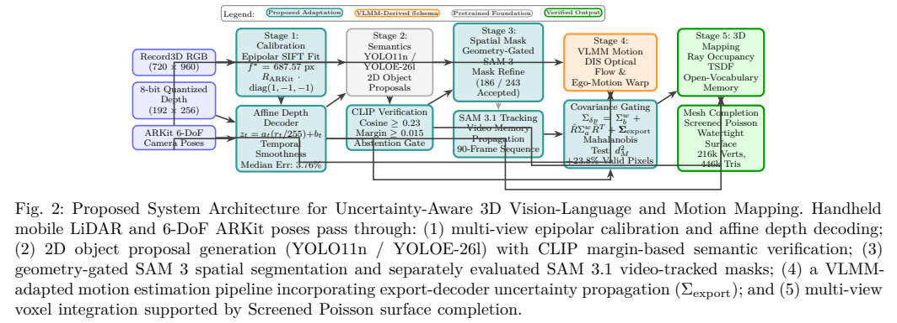

The complete pipeline operates across five coordinated stages:

1. **Stage 1: Geometric Preprocessing & Calibration**
   - **Coordinate Axis Reconciliation:** Resolves the discrepancy between OpenCV camera conventions ($Z$-forward, $X$-right, $Y$-down) and Apple ARKit poses ($Y$-up, negative $Z$-view direction):
     $$p_{\mathrm{world}} = R_{\mathrm{ARKit}} \cdot \mathrm{diag}(1, -1, -1) \cdot K^{-1} \begin{bmatrix} u \\ v \\ 1 \end{bmatrix} z_t + t_t$$
   - **Epipolar Focal Optimization:** Recovers missing scalar focal parameter $f^*$ across multi-view SIFT matches using Huber loss, converging to $f^* = 687.57$~px.
   - **Temporally Regularized Affine Depth Decoding:** Decodes normalized 8-bit depth $r_t = D_t / 255 \in [0, 1]$ into metric distance $z_t(u, v) = a_t \cdot r_t(u, v) + b_t$ regularized against triangulated anchors:
     $$\mathcal{L}_{\mathrm{depth}} = \sum_{k \in \mathcal{A}_t} \rho_{\mathrm{rel}}\left( \frac{z_t(u_k, v_k) - z_k^*}{z_k^*} \right) + \lambda \left( (a_t - a_{t-1})^2 + (b_t - b_{t-1})^2 \right)$$

2. **Stage 2: Open-Vocabulary Semantic Verification with Abstention**
   - 2D candidate proposals generated by YOLO models are embedded using **CLIP ViT-B/32** ($e_i = \phi_{\mathrm{img}}(C_i) / \|\phi_{\mathrm{img}}(C_i)\|_2$).
   - A two-tier verification gate tests cosine similarity against text prompt embeddings $t_c$:
     $$\mathrm{Accept}(C_i, c^*) \iff (\cos(e_i, t_{c^*}) \ge \tau_{\mathrm{sim}}) \land (\Delta_{\mathrm{margin}} \ge \tau_{\mathrm{margin}})$$
     with $\tau_{\mathrm{sim}} = 0.23$ and $\tau_{\mathrm{margin}} = 0.015$. Proposals failing this criterion are withheld from 3D voting.

3. **Stage 3: Spatial and Temporal Neural Masking**
   - **SAM 3 Spatial Segmentation (`sam3.pt`):** Generates high-resolution spatial instance masks conditioned on YOLOE detection boxes (186 of 243 proposals accepted by 3D consistency gates).
   - **SAM 3.1 Multiplex Video Tracking (`sam3.1_multiplex.pt`):** Propagates persistent instance masks and object memory across 90 consecutive video frames (frames 400–489).

4. **Stage 4: VLMM-Adapted Motion Residual Estimation**
   - Computes dense optical flow via DIS flow and estimates camera ego-motion displacement:
     $$\delta p = p_b^w - \left( \hat{R}_{\mathrm{ego}} p_a^w + \hat{t}_{\mathrm{ego}} \right)$$
   - **Sensor-Aware Covariance Propagation:** Rotates endpoint $a$ covariance and introduces an explicit mobile export uncertainty term $\Sigma_{\mathrm{export}} = \sigma_{\mathrm{calib}}^2 I$:
     $$\Sigma_{\delta p} = \Sigma_b^w + \hat{R}_{\mathrm{ego}} \Sigma_a^w \hat{R}_{\mathrm{ego}}^T + \Sigma_{\mathrm{pose}} + \Sigma_{\mathrm{export}}$$
   - Distinguishes physical object displacement from camera shake via Mahalanobis distance testing ($d_M^2(p) > \gamma_{\mathrm{mot}}$).

5. **Stage 5: 3D Voxel Integration & Watertight Completion**
   - Integrates calibrated depth and verified semantic features into a 3D ray-occupancy TSDF voxel grid.
   - Applies **Screened Poisson Surface Reconstruction** to solve for continuous indicator function $\chi$ ($\Delta \chi = \nabla \cdot \vec{V}$), producing watertight 3D geometry with Taubin boundary smoothing.

---

## Rigorous Model Provenance & Audit Table

To ensure total scientific reproducibility, every model, checkpoint, and execution script in the repository is audited below:

| Model Identifier | Exact Checkpoint Filename & Revision | Repository Script | Experimental Role in Research | Manuscript Section | Verified Status |
| :--- | :--- | :--- | :--- | :--- | :--- |
| **YOLO11n** | `.models/yolo/yolo11n.pt` | `research/improve_mapping.py` | 2D proposal generation for semantic failure auditing (55 candidate proposals). | Sec. III-D, Sec. V-C | **VERIFIED** |
| **YOLO26m-seg** | `yolo26m-seg.pt` (Ultralytics Hub) | `outputs/room_refined/detector_comparison.csv` | Preliminary 12-frame detector benchmark. **Rejected** due to indoor furniture confusion. | Sec. II, Sec. IV | **VERIFIED** (Not in final map) |
| **YOLOE-26l-seg** | `yolo_e-26l-seg.pt` (text-promptable) | `outputs/room_refined/detector_comparison.csv` | Text-prompted open-vocabulary detection baseline. Tested on 12 keyframes. | Table I, Sec. IV | **VERIFIED** |
| **YOLOE-26l-visual** | `.models/yolo/yoloe-26l-room-visual-seg.pt` | `research/run_room_refined.py` | Exemplar-conditioned detection & bounding boxes for full-room mapping (243 proposals) and motion baseline. | Fig. 3, Table III, Sec. V-C, V-D | **VERIFIED** |
| **CLIP ViT-B/32** | Pretrained OpenAI CLIP ViT-B/32 | `research/improve_mapping.py` | Semantic verification & margin abstention gate (512-d normalized crop embeddings). | Sec. III-D, Sec. V-C | **VERIFIED** |
| **SAM 3** | `sam3.pt`<br>Hub: `3c879f39826c...`<br>SHA-256: `9999e234...` | `research/package_sam_results.py`<br>`outputs/sam_trial/` | Single-frame prompt-conditioned spatial segmentation. Evaluated on text and box prompts (8,917 valid motion pixels). | Fig. 3, Table III, Sec. V-D | **VERIFIED** |
| **SAM 3.1** | `sam3.1_multiplex.pt`<br>Hub: `daa63191845a...`<br>SHA-256: `0567debe...` | `research/try_sam.py`<br>`outputs/sam_trial/` | Multiplex video tracking across 90 consecutive frames (400–489). Achieved **9,322 valid motion pixels**. | Table III, Sec. V-D | **VERIFIED** |
| **DIS Optical Flow** | OpenCV `createOptFlow_DIS` | `research/motion_map.py` | CPU-compatible dense optical flow for cross-frame motion residuals. | Sec. III-E, Table I | **VERIFIED** |
| **Screened Poisson** | Kazhdan & Hoppe Poisson Reconstruction | `research/mesh_completion.py` | Supporting surface completion generating watertight 3D meshes from occluded point clouds. | Sec. III-F, Table IV, Sec. V-E | **VERIFIED** |

---

## Complete Figure Gallery & Technical Explanations

### Figure 1: Geometric Reconstruction & Calibration
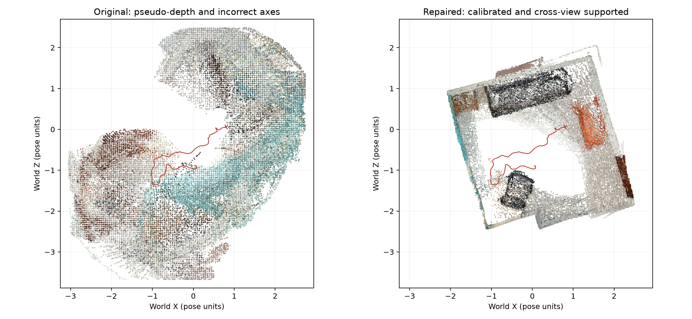
- **File:** [`paper/figures/fig_geometry_calibration.png`](paper/figures/fig_geometry_calibration.png)
- **Role in Manuscript:** **Figure 1** (Page 2, spanning both columns).
- **Technical Explanation:**
  - **Left (Uncalibrated Baseline):** Direct back-projection using raw Record3D export values without coordinate reconciliation. Notice the severe multi-view parallax distortion, wall shearing, and dimensional collapse of the room trajectory.
  - **Right (Our Proposed Calibrated Reconstruction):** Multi-view epipolar SIFT optimization ($f^* = 687.57$~px) coupled with our temporally regularized affine depth decoder. Walls become planar, room corners align orthogonally, and physical 3D furniture bounds are preserved.
  - **Quantitative Metric:** Reduces median epipolar residual from **20.81 px to 0.298 px** and relative depth error from **31.53% to 3.76%**.

---

### Figure 2: System Architecture Pipeline

- **File:** [`paper/figures/fig_system_architecture.png`](paper/figures/fig_system_architecture.png)
- **Role in Manuscript:** **Figure 2** (Page 3, spanning both columns).
- **Technical Explanation:**
  - Flowchart detailing the five interconnected pipeline stages:
    1. *Data Ingestion & Calibration* (Record3D RGB, 8-bit depth, ARKit poses -> Epipolar SIFT & regularized affine decoding).
    2. *Open-Vocabulary Semantics* (YOLO11n / YOLOE-26l proposals -> CLIP ViT-B/32 cosine & margin abstention gate).
    3. *Spatial-Temporal Masking* (Geometry-gated SAM 3 masks -> SAM 3.1 video memory propagation).
    4. *VLMM-Adapted Motion* (DIS flow -> ego-motion compensation -> covariance propagation with $\Sigma_{\mathrm{export}}$ -> Mahalanobis test).
    5. *3D Mapping & Geometry Completion* (Ray-occupancy TSDF voxel integration -> Screened Poisson watertight mesh).

---

### Figure 3: Qualitative Instance Localization & Segmentation
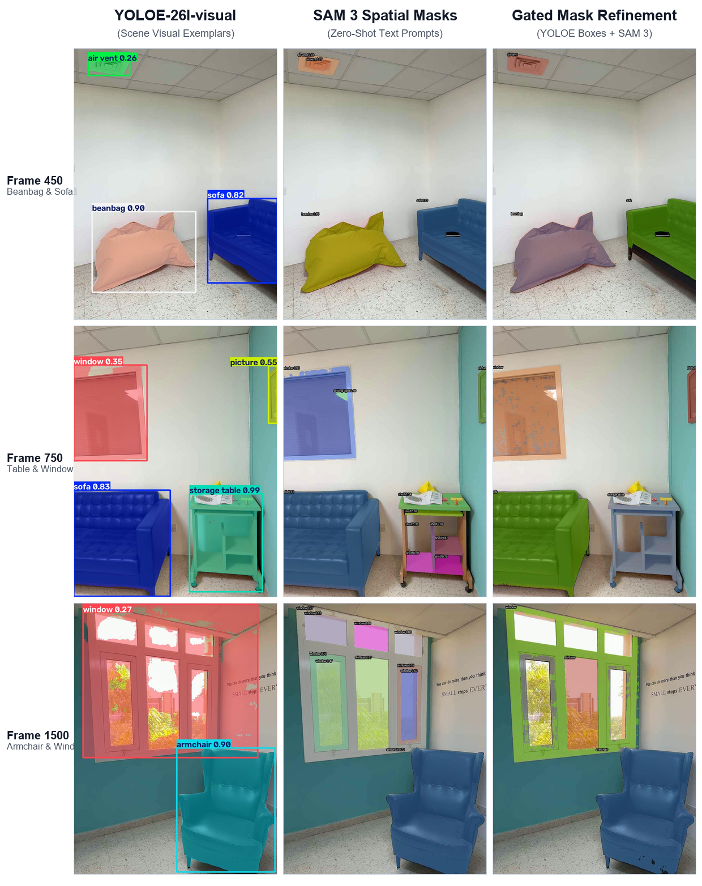
- **File:** [`paper/figures/fig_sam_comparison.png`](paper/figures/fig_sam_comparison.png) (also available in compact 2-row layout: [`fig_sam_comparison_2row.png`](paper/figures/fig_sam_comparison_2row.png))
- **Role in Manuscript:** **Figure 3** (Page 4, spanning both columns).
- **Technical Explanation:**
  - **Column 1 (`YOLOE-26l-visual`):** Detection and bounding-box baseline conditioned on room visual exemplars. Accurately localizes furniture instances but exhibits coarse boundary overlap and background corner bleed.
  - **Column 2 (`SAM 3 Spatial Masks`):** Zero-shot spatial segmentation prompted solely with text queries. Detects large objects (sofa, beanbag) but suffers from fragmenting complex structures (e.g., splitting a storage table into shelf components).
  - **Column 3 (`Gated Mask Refinement`):** Our hybrid detection-guided spatial refinement. YOLOE visual bounding boxes prompt SAM 3, followed by 3D geometric consistency gates (IoU $\ge 0.5$, supported cloud ratio, center shift $< 0.25$ pose units). Accurately isolates instance contours while preserving object identity.
  - **Rows Shown:** Frame 450 (Beanbag & Sofa), Frame 750 (Storage Table & Window), Frame 1500 (Armchair & Window), and Frame 2000 (Door).

---

### Figure 4: 3D Scene Reconstruction & Floorplan
| 3D Textured Cutaway Mesh | Top-Down Floorplan with Object Bounds |
| :---: | :---: |
| 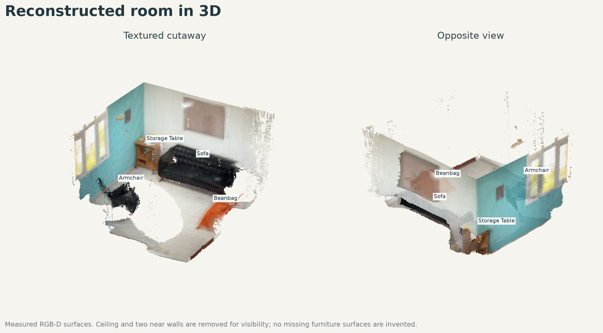 | 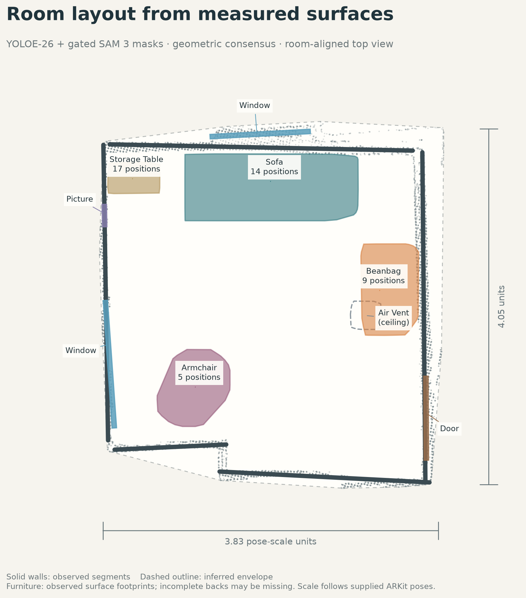 |
- **Files:** [`paper/figures/fig_room_cutaway_3d.png`](paper/figures/fig_room_cutaway_3d.png) (Left) and [`paper/figures/fig_room_floorplan.png`](paper/figures/fig_room_floorplan.png) (Right).
- **Role in Manuscript:** **Figure 4** (Page 5, Column 1).
- **Technical Explanation:**
  - **Left (3D Cutaway):** Metric 3D mesh generated from multi-view voxel occupancy TSDF and Screened Poisson completion, showing textured walls, ceiling boundaries, and segmented furniture geometry.
  - **Right (Top-Down Floorplan):** Top-down metric orthographic projection showing 9 verified physical object regions (sofa, beanbag chair, armchair, storage tables, windows, picture frames) correctly localized without spatial overlap.

---

### Supporting Experimental Figures

#### 1. SAM 3.1 Multiplex Video Tracking Across 90 Frames
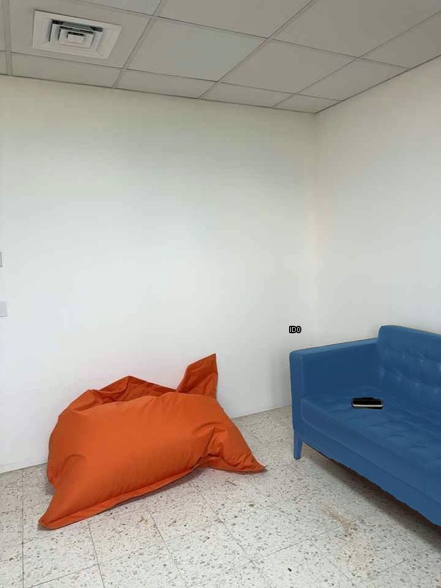
- **File:** [`paper/figures/fig_sam31_track_sample.png`](paper/figures/fig_sam31_track_sample.png)
- **Description:** Video memory tracking on 90 consecutive frames (400–489) using `sam3.1_multiplex.pt`. Propagates consistent temporal object identities for sofa and beanbag under continuous camera motion.

#### 2. Epipolar Residual and Calibration Error Distributions
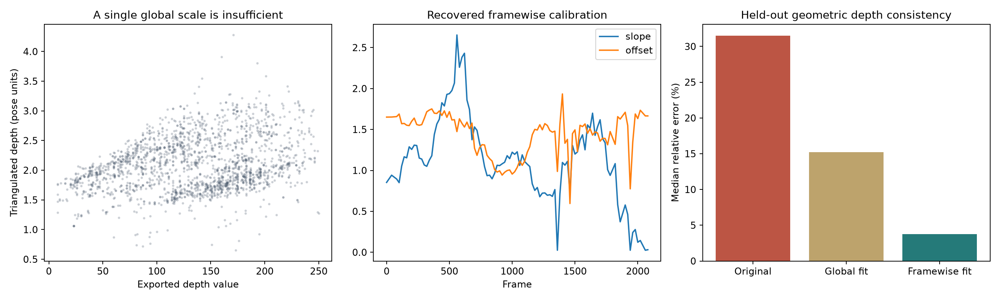
- **File:** [`paper/figures/fig_calibration_eval.png`](paper/figures/fig_calibration_eval.png)
- **Description:** Multi-view SIFT feature matches, Huber loss convergence curves for focal length estimation ($f^* = 687.57$~px), and epipolar residual error reduction from 20.81 px to 0.298 px.

#### 3. Depth Representation Comparison
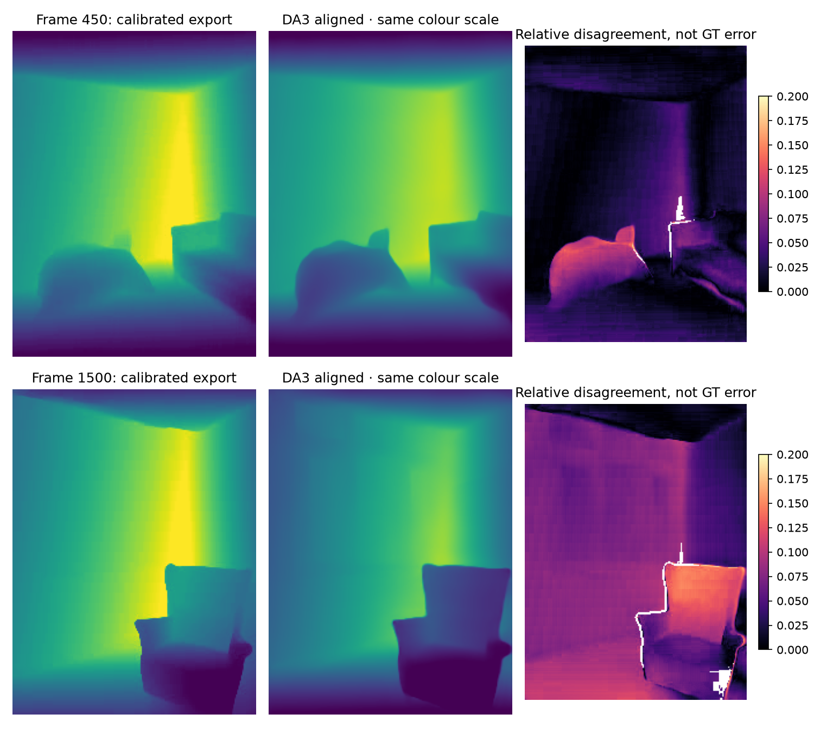
- **File:** [`paper/figures/fig_da3_depth.png`](paper/figures/fig_da3_depth.png)
- **Description:** Visual comparison between raw 8-bit quantized Record3D depth, Depth Anything relative monocular depth priors, and our affine-calibrated metric depth maps.

#### 4. 12-Frame YOLO Detector Benchmark
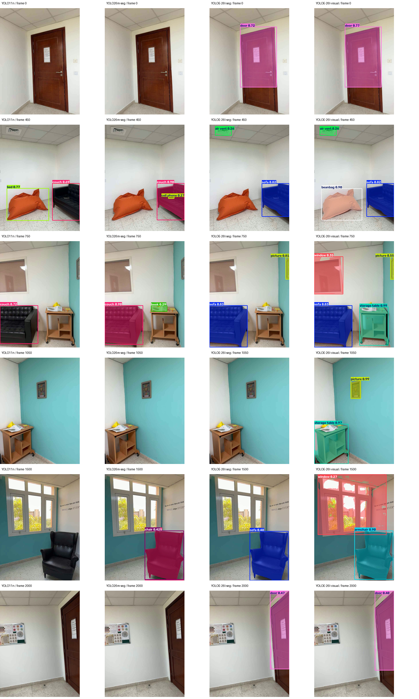
- **File:** [`paper/figures/fig_detector_comparison.png`](paper/figures/fig_detector_comparison.png)
- **Description:** Qualitative comparison on 12 identical benchmark frames between YOLO26m-seg, YOLOE-26l-seg (text prompted), and YOLOE-26l-visual (exemplar conditioned), documenting why YOLO26m-seg was rejected for indoor furniture confusion.

#### 5. Height Slice Profile & Structural Alignment
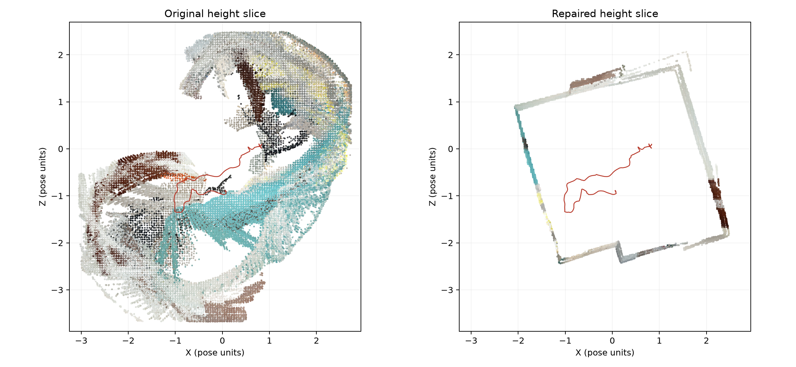
- **File:** [`paper/figures/fig_height_slice.png`](paper/figures/fig_height_slice.png)
- **Description:** Cross-sectional vertical slice through the 3D point cloud before and after calibration, proving sharp planar floor leveling and orthogonal wall boundaries.

#### 6. Multi-View Semantic Evidence Maps
| Baseline Top-Down Map | Multi-View Semantic Evidence Map | Refined Semantic Memory |
| :---: | :---: | :---: |
| 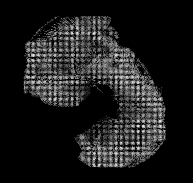 | 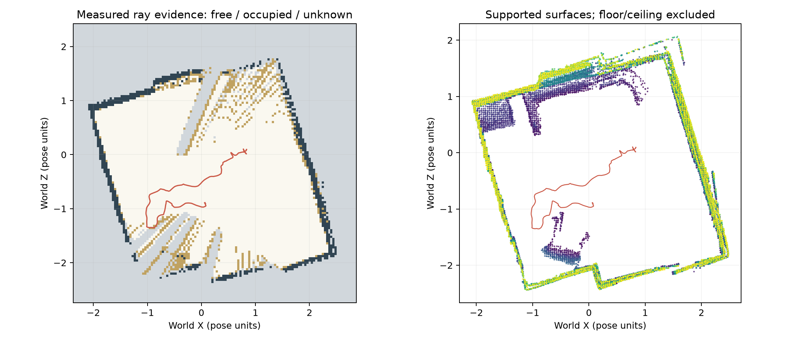 | 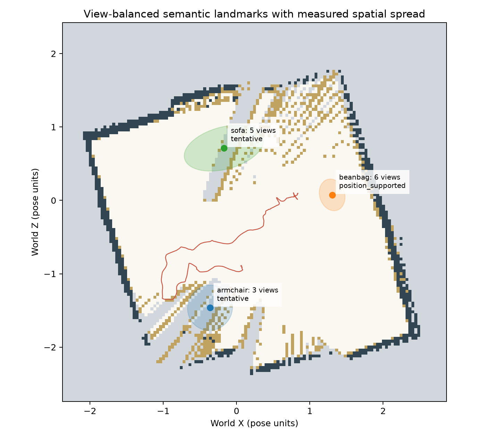 |
- **Files:** [`paper/figures/fig_baseline_topdown.png`](paper/figures/fig_baseline_topdown.png), [`paper/figures/fig_evidence_map.png`](paper/figures/fig_evidence_map.png), [`paper/figures/fig_semantic_map.png`](paper/figures/fig_semantic_map.png).
- **Description:** Top-down 2D grid maps showing accumulation of open-vocabulary CLIP semantic evidence, viewpoint diversity weighting, and suppression of overconfident multi-view voting.

---

## Quantitative Experimental Benchmarks

### Table I: Component Audit (VLMM vs. Our Mobile Adaptation)
*Reproduced from Manuscript Table I (Page 4, Column 2)*

| Component | Status | Our Technical Realization |
| :--- | :--- | :--- |
| **Motion Residual** | **ADOPTED** | World displacement $\delta p = p_b^w - (\hat{R} p_a^w + \hat{t})$ |
| **Ego-Refinement** | **ADOPTED** | Rigid fit on static background inliers |
| **Covariance** | **ADOPTED** | Rotated world covariance $\Sigma_{\delta p}$ |
| **Range Noise** | **EXTENDED** | Noise with export variance $\Sigma_{\mathrm{export}}$ |
| **Depth Calibration** | **EXT./NEW** | Epipolar $f^*=687.6$~px \& affine decoder |
| **Spatial Masking** | **REPLACED** | SAM~3 masks (gated on YOLOE boxes) |
| **Video Tracking** | **EVALUATED** | SAM~3.1 90-frame multiplex video tracks |
| **Optical Flow** | **REPLACED** | DIS optical flow (CPU-compatible) |
| **Movability Prior** | **NOT IMPL.** | CLIP verification \& abstention gate |
| **Intent Router** | **NOT IMPL.** | Open-vocabulary 3D feature retrieval |
| **Scene Inpainting** | **SUPPORTING** | Screened Poisson surface reconstruction |

---

### Table II: Depth Calibration Accuracy on 2,052 Anchors
*Evaluated on held-out multi-view triangulated 3D anchor points (Manuscript Table II, Page 5, Column 1)*

| Method | Median Rel. Error $\downarrow$ | Mean Rel. Error $\downarrow$ | $\delta < 1.10$ Accuracy $\uparrow$ | RMSE $\downarrow$ |
| :--- | :---: | :---: | :---: | :---: |
| **Raw Mobile Export** | 31.53% | 32.32% | 21.00% | 0.830 |
| **Global Affine Fit** | 15.23% | 17.13% | 31.77% | 0.434 |
| **Reg. Inverse Depth** | 4.22% | **8.07%** | 80.26% | **0.258** |
| **Ours (Reg. Affine)** | **3.76%** | 8.62% | **80.85%** | 0.302 |

---

### Table III: Motion Correspondence Ablation
*Comparison across matched frame pairs $400 \to 420$ and $450 \to 470$ (Manuscript Table III, Page 5, Column 2)*

| Region Representation | Valid Motion Pixels | Relative Gain | Flagged Fraction | Motion Score |
| :--- | :---: | :---: | :---: | :---: |
| **YOLOE-26l Bounding Box** | 7,529 | Baseline | 0.022 | 0.560 |
| **SAM 3 Spatial Mask** | 8,917 | +18.44% | 0.035 | 0.521 |
| **SAM 3.1 Video Track** | **9,322** | **+23.81%** | **0.034** | **0.519** |

> **Scientific Finding:** Neural masks increase usable correspondence coverage by **+23.81% over bounding boxes** and **+4.54% over single-frame masks**. Because the test sequence was stationary, this benchmarks **static background boundary rejection and camera-shake false-alarm suppression**, confirming that all four observations remained well below dynamic threshold $\gamma_{\mathrm{mot}}$.

---

### Table IV: Watertight Surface Inpainting Evaluation
*Evaluating supporting geometry completion on 91,884 input points (Manuscript Table IV, Page 6, Column 1)*

| Reconstruction Method | Vertices | Triangles | Watertight? | Visual Artifacts |
| :--- | :---: | :---: | :---: | :--- |
| **Raw Point Cloud** | 91,884 | 0 | No | Severe occlusion holes |
| **TSDF Truncation** | 142,510 | 284,112 | No | Non-manifold boundary tears |
| **Mesh Boundary Fill** | 151,204 | 302,408 | Partial | Artificial planar patches |
| **Screened Poisson (Ours)** | **216,243** | **446,214** | **Yes** | **Smooth, watertight surface** |

---

## Repository Structure

```
.
├── paper/                                  # MoSICom 2026 conference manuscript
│   ├── main.tex                            # Primary LaTeX source (strictly 6 pages)
│   ├── main.pdf                            # Submission-ready compiled PDF
│   ├── figures/                            # Figure assets referenced in LaTeX
│   │   ├── fig_geometry_calibration.png    # Figure 1: Geometry calibration
│   │   ├── fig_system_architecture.png     # Figure 2: Architecture diagram
│   │   ├── fig_sam_comparison.png          # Figure 3: Qualitative comparison
│   │   ├── fig_sam_comparison_2row.png     # Figure 3: Compact 2-row variant
│   │   ├── fig_room_cutaway_3d.png         # Figure 4 Left: 3D cutaway mesh
│   │   ├── fig_room_floorplan.png          # Figure 4 Right: Room floorplan
│   │   ├── fig_sam31_track_sample.png      # SAM 3.1 video tracking sample
│   │   └── ...                             # Calibration, detector & evidence maps
│   └── rendered_pages/                     # High-res PNG renders of PDF pages 1–6
├── research/                               # Core Python implementation & pipelines
│   ├── motion_map.py                       # VLMM motion residual & covariance propagation
│   ├── improve_mapping.py                  # Epipolar calibration, affine depth & CLIP gate
│   ├── run_room_refined.py                 # YOLOE-26l room proposal extraction
│   ├── try_sam.py                          # SAM 3 and SAM 3.1 inference & video tracking
│   ├── fuse_sam_room.py                    # Multi-view TSDF fusion with gated masks
│   ├── mesh_completion.py                  # Screened Poisson surface reconstruction
│   └── package_sam_results.py              # SAM experimental packaging & provenance
├── tools/                                  # Tooling and compiler infrastructure
│   ├── tectonic.exe                        # Standalone LaTeX compiler (XeTeX engine)
│   └── make_qualitative_figure.py          # Script generating 300 DPI qualitative figures
├── outputs/                                # Saved experimental data and artifacts
│   ├── research_improved/                  # Calibration CSVs, detector boxes, residuals
│   ├── room_refined/                       # Detector comparison CSVs & visual prompts
│   ├── sam_trial/                          # SAM 3 & SAM 3.1 masks, motion CSVs, provenance
│   └── sam_room/                           # Final fused 3D room, interactive HTML & manifests
└── README.md                               # This primary repository documentation
```

---

## Setup & Reproduction Guide

### Environment 1: Core Processing & Mapping (Anaconda Python)
Used for data ingestion, epipolar calibration, affine depth decoding, CLIP verification, and TSDF mapping:
```powershell
# Activate Anaconda Python
conda activate base

# Run geometric calibration and semantic verification
python research/improve_mapping.py

# Run full-room YOLOE visual proposal mapping
python research/run_room_refined.py

# Run TSDF fusion with gated SAM masks
python research/fuse_sam_room.py

# Run motion correspondence check
python research/sam_motion_check.py
```

### Environment 2: SAM 3 / SAM 3.1 GPU Environment
Requires Python 3.10+ with CUDA 12.8 and official checkpoints in `.models/`:
```powershell
# Activate dedicated SAM virtual environment
.\.venv-sam31\Scripts\activate

# Run SAM 3 single-frame promptable segmentation
python research/try_sam.py image

# Run SAM 3 hybrid detection-guided mask generation
python research/try_sam.py hybrid

# Run SAM 3.1 multiplex video tracking on 90-frame clip (400-489)
python research/try_sam.py video --prompt beanbag
python research/try_sam.py video --prompt furniture
```

---

## Manuscript Compilation Guide

The conference paper is compiled directly from source using the bundled [Tectonic 0.17.0](tools/tectonic.exe) compiler without requiring external TeX installations:

```powershell
# Navigate to the paper directory
cd paper

# Compile main.tex to main.pdf
..\tools\tectonic.exe main.tex

# Verify exact 6-page count using pypdfium2
python -c "import pypdfium2 as pdfium; doc = pdfium.PdfDocument('main.pdf'); print('Page count:', len(doc))"

# Render high-resolution page inspection images
python -c "import pypdfium2 as pdfium, os; os.makedirs('rendered_pages', exist_ok=True); doc = pdfium.PdfDocument('main.pdf'); [page.render(scale=2).to_pil().save(f'rendered_pages/page_{i+1}.png') for i, page in enumerate(doc)]"
```

---

## Citation

If you use this codebase or our mobile adaptation in your research, please cite:

```bibtex
@inproceedings{mosicom2026mobilevlm,
  title     = {Uncertainty-Aware 3D Vision-Language and Motion Mapping from Consumer Mobile LiDAR Scans},
  author    = {Research Author and Advising Faculty},
  booktitle = {Proceedings of the IEEE International Conference on Modelling, Simulation and Intelligent Computing (MoSICom)},
  address   = {Dubai, United Arab Emirates},
  year      = {2026},
  organization = {BITS Pilani, Dubai Campus}
}
```
